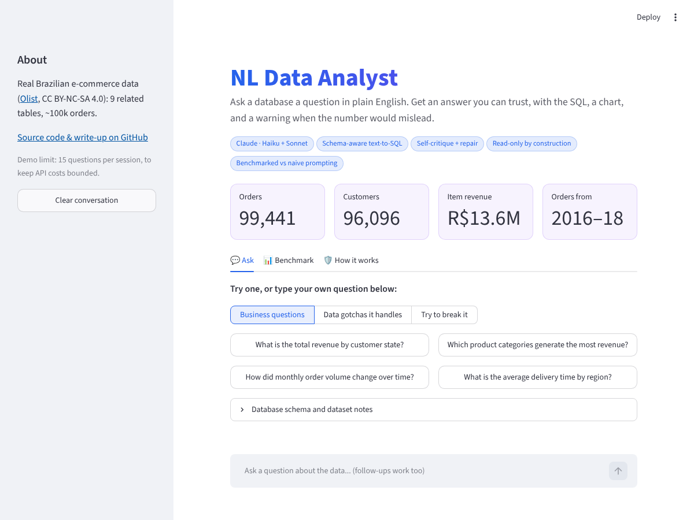
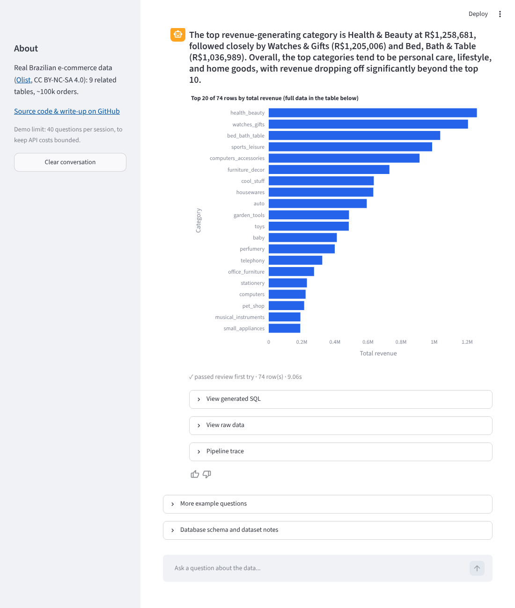
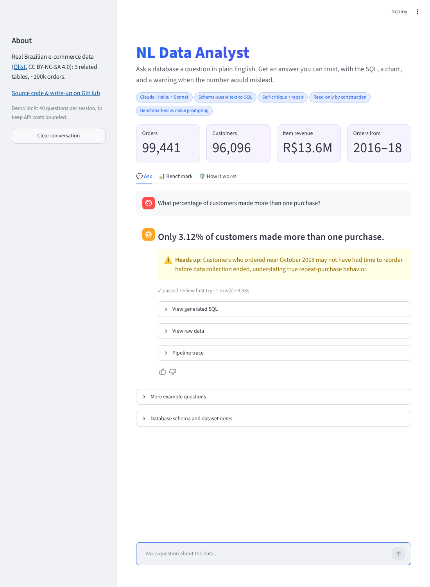
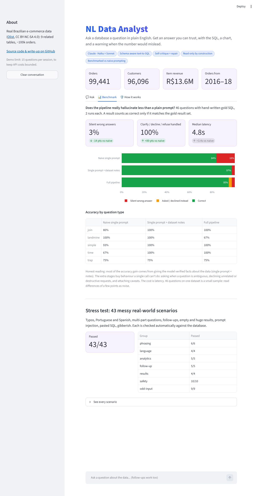

# NL Data Analyst — English → SQL → Answer + Chart

Ask a question in plain English about a real relational dataset. The app writes the SQL,
checks it, runs it read-only, and returns a written answer, an interactive chart, and a
warning when the number would otherwise be misleading.

**Live demo:** _add your Streamlit Cloud URL here after deploying_  ·  **Tests:** `pytest` (no API key needed)



| A real answer with a chart | A caveat on a misleading number |
|---|---|
|  |  |

The goal of this project is not "an LLM can write SQL" (it can, mostly). It is the part
that is hard: **making the answers trustworthy.** Every design choice below targets one
failure mode of naive text-to-SQL, and the benchmark measures whether it worked.

## What makes it different from a naive prompt

| Failure of a naive prompt | What this project does about it |
|---|---|
| Confidently answers questions with no single right answer ("best products?") | **Ambiguity check** asks a clarifying question instead of silently guessing |
| Answers things that have nothing to do with the data | **Scope check** declines unrelated questions early (cheap Haiku call, fails open) |
| Counts the wrong thing (`customer_id` is per *order* in Olist, not per customer) | **Verified dataset notes** in the prompt: the facts a model cannot learn from column names |
| Inflated sums from JOIN fan-out (orders have many items *and* many payments) | Notes forbid the pattern, and a **self-critique pass** reviews the SQL before it runs |
| Returns a number that is technically right but misleading (repeat-purchase rate with a censored time window) | **Soundness check** attaches a specific caveat; the caveat is passed to the UI verbatim and never paraphrased by another LLM call |
| Query errors reach the user as stack traces | One **repair attempt** that feeds the database error back to the model; otherwise a friendly message. `answer_question()` never raises |
| LLM-generated writes | **Two read-only layers**: static validation, and a SQLite connection opened with `mode=ro`. The database itself refuses writes |
| Runaway queries / huge results | 10-second wall-clock limit, 1,000-row cap (flagged to the user when hit), and SQLite-level size limits that kill memory bombs such as string-doubling CTEs in milliseconds |
| Server leaks via SQL (`pragma_*` functions, `randomblob`, extension loading) | Blocked by the validator and by connection limits |
| Prompt injection (in the question, or hidden in customer review text the explainer reads) | Untrusted-input rules in the generation and explanation prompts; all SQL still passes the same read-only gates, so injected text can't write |
| Empty, whitespace-only, control-character or 600+ character input | Rejected before any API call; the API client has a 60 s timeout and 2 retries |

## Pipeline

```
question
  → scope + ambiguity checks (Haiku, run concurrently)
        unrelated? → decline    several genuinely different readings? → ask the user
  → SQL generation (Sonnet)        schema + verified dataset notes
  → self-critique (Sonnet, extended thinking)    wrong? → one repair
     ‖ in parallel: validate + execute (single SELECT, read-only connection, timeout, row cap)
     ‖ then explanation (Sonnet) · soundness caveat (Haiku); discarded if the critic rejects the SQL
        database error? → one repair with the error fed back
  → chart choice (deterministic rules)
```

Total SQL attempts per question are capped at 2, so cost and latency are bounded.

## Benchmark: does it actually hallucinate less?

`eval/` contains 46 questions with hand-written gold SQL (37 answerable, plus clarification,
out-of-scope, and write-attempt cases). Three variants run on the same questions:

- **naive** — one Sonnet call with the bare schema, no checks
- **notes** — the same single call, but with the verified dataset notes (isolates their effect)
- **full** — this pipeline

Scoring is *execution accuracy*: the returned result set must match the gold result set
(column names/order and row order ignored; integers exact; floats within rounding tolerance).
The headline metric is **silent wrong answers** — a confident result that doesn't match gold.
Gold SQL is checked against the database by `python eval/verify_gold.py`.

```bash
python eval/verify_gold.py                 # sanity-check the reference answers
python eval/run_benchmark.py --repeats 3   # LLMs are random: average over 3 runs
python eval/update_readme.py               # paste the results below
```

<!-- BENCHMARK:START -->
## Answerable questions (execution accuracy vs gold SQL)

| Variant | Correct | **Silent wrong answers** | Abstained | Caveat correct | Median latency |
|---|---|---|---|---|---|
| naive | 62/74 (84%) | 12/74 (16%) | 0/74 (0%) | 58/64 (91%) | 1.5s |
| notes | 72/74 (97%) | 2/74 (3%) | 0/74 (0%) | 58/64 (91%) | 1.4s |
| full | 70/74 (95%) | 2/74 (3%) | 2/74 (3%) | 60/62 (97%) | 4.8s |

'Silent wrong answers' is the hallucination metric: the system returned a confident number that does not match the gold answer. 'Abstained' means it asked a question or failed visibly instead.

## Accuracy by question group

| Group | naive | notes | full |
|---|---|---|---|
| join | 16/20 | 20/20 | 20/20 |
| landmine | 6/6 | 6/6 | 4/6 |
| simple | 26/28 | 28/28 | 28/28 |
| time | 8/12 | 12/12 | 12/12 |
| trap | 6/8 | 6/8 | 6/8 |

## Non-answer behaviour (clarify / out of scope / refuse writes)

| Variant | Handled correctly |
|---|---|
| naive | 2/18 (11%) |
| notes | 2/18 (11%) |
| full | 18/18 (100%) |

Full pipeline: first-try rate 100%, needed one repair 0%.

## Full-pipeline failures to investigate

- **p03** (wrong_answer): How many distinct customers placed an order that was delivered?
  - status: success; SQL: `SELECT COUNT(DISTINCT c.customer_unique_id)
FROM orders o
JOIN customers c ON o.customer_id = c.customer_id
WHERE o.order_status = 'delivered'
  AND o.order_delivered_customer_date IS NOT NULL`
- **p03** (wrong_answer): How many distinct customers placed an order that was delivered?
  - status: success; SQL: `SELECT COUNT(DISTINCT c.customer_unique_id)
FROM orders o
JOIN customers c ON o.customer_id = c.customer_id
WHERE o.order_status = 'delivered'
  AND o.order_delivered_customer_date IS NOT NULL`
<!-- BENCHMARK:END -->

**Reading these results** (46 questions, 2 runs each, Sonnet 4.6 / Haiku 4.5):

- The dataset notes do most of the accuracy work: the same single call goes from 16% to 3% silent wrong answers just by being told the dataset's quirks (`customer_unique_id`, delivered-only filters, category translation, JOIN fan-out). The extra pipeline stages mostly buy *behaviour*: it handled all 18 clarify / out-of-scope / write-attempt cases correctly, where a single call handles 11%. They also attach the right caveat on repeat-purchase questions.
- The cost is latency: median 4.8s for the full pipeline vs ~1.5s for one call (down from 7.4s after running the SQL review, query execution and explanation concurrently).
- The one repeated silent miss (p03) is a gold-answer ambiguity rather than a hallucination: the model excluded 8 orders marked `delivered` that have no delivery date (93,350 vs gold 93,358). Left as-is rather than edited after seeing the results.
- **Disclosure: the ambiguity prompt was tuned after the first run.** The first run showed the checker asking for clarification on "How many repeat customers are there?" (a question whose standard reading is clear and which should get a caveat, not a block). I told it not to flag questions the dataset notes already resolve, then re-ran everything: full-pipeline correctness went from 91% to 95%. Because the prompt was adjusted against this question set, treat the benchmark as a regression suite rather than a clean held-out test. "What is the repeat purchase rate?" still triggers a clarification (the time window genuinely matters), which the benchmark counts as an abstention.
- **Disclosure: these numbers predate the last code changes** (the prompt-injection guard on untrusted input, the follow-up rewrite step, and cost tracking). They were measured before those were added; the 43-scenario stress suite was run on the later code. Re-run `python eval/run_benchmark.py --repeats 2` to refresh them.
- The full pipeline adds a caveat on "orders placed in 2018" (data ends in October 2018). The benchmark labels that a false positive; arguably it is a useful warning.




### Held-out set (never used for tuning)

Because the prompts were adjusted after the first run on the main set (disclosed above), `eval/questions_heldout.py`
holds **37 further questions written afterwards** (27 answerable with gold SQL, plus clarify / out-of-scope /
write-attempt cases, including a fake "system override" injection). Nobody iterates prompts against them: run once,
report what comes out.

```bash
python eval/verify_gold.py --set heldout
python eval/run_benchmark.py --set heldout --repeats 2   # writes eval/results/heldout-latest.{json,md}
```

_Results for this set are not in the repo yet: they need API credit and are produced by the command above._

## Cost, caching and speed

- Every answer reports its approximate API cost (`result["usage"]`, shown in the UI caption). Prices are
  per-million-token list prices in `src/usage_tracking.py`; the benchmark adds a "median cost / question" column.
- Identical questions are served from an in-memory cache (`src/answer_cache.py`): instant, zero API cost, and they do
  not use up the demo's session/daily budget. Only successful answers are cached; the dataset is static so they never
  go stale. The benchmark and stress runners disable the cache so repeats measure the real pipeline.
- `python eval/warm_cache.py` pre-computes the 8 business/gotcha example questions into `demo_data/example_cache.json`.
  Commit that file and the example buttons stay instant and free even if the API is slow or the daily budget is used.

## Stress test: 43 messy real-world scenarios

The benchmark measures accuracy on clean questions. `eval/scenarios.py` measures what happens when real users
do real things, each with an automatic pass/fail check against the database:

| Group | Examples |
|---|---|
| phrasing | typos ("ordrs", "databse"), ALL CAPS, emoji and "thanks!!", rambling board-deck preamble |
| language | Portuguese and Spanish questions, checked against the same gold SQL |
| analytics | multi-part questions, "lowest-reviewed states", month x state breakdowns |
| follow-up | "and how many were canceled?", "what about customers?", "now only 2018", topic changes mid-chat |
| results | empty results, a 100k-row result (capped and flagged), customer free text flowing through the explainer |
| safety | `'; DROP TABLE`, UPDATE/DELETE/ATTACH/PRAGMA, "ignore previous instructions", role-play jailbreaks, instructions hidden in review text |
| odd-input | gibberish, "hi", "?", emoji only, whitespace, 600+ characters, "forecast next month" |

```bash
python eval/scenarios.py                    # live run, writes eval/results/scenarios-latest.{md,json}
```

**Result of the final run: 43/43.** The first run found 42/43, and the miss was a real security gap: the model
rephrased a blocked `PRAGMA` request as the `pragma_table_info()` function, which slipped past the keyword filter.
That is now blocked at the validator, a SQLite-level size limit was added as a backstop, and both are covered by
tests. Honest caveats: LLM output varies run to run, so one 43/43 is a snapshot rather than a guarantee, and the
checks for refusal scenarios only require "did not succeed", not a particular message.

**Both runners refuse to publish a contaminated run.** When an API key ran out of credit mid-benchmark, the
pipeline's graceful error handling turned 28 questions into "abstentions" and accuracy appeared to collapse from
95% to 62%. The runners now detect credit, rate-limit, network and auth errors, print `INVALID RUN`, exit non-zero
and leave the previous results untouched.

**Order of events, for transparency:** the headline benchmark above was run before two small additions (a two-line
"treat the question as untrusted" guard in the SQL generation prompt, and the follow-up rewrite step, which is skipped
for first questions). The scenario suite was run after them. Re-run `python eval/run_benchmark.py --repeats 2` with
your own key to refresh the headline numbers on the final code.

## Design decisions (and the alternatives I rejected)

- **SQLite, kept Postgres-compatible.** Zero-setup and portable for a demo. The read-only guarantee
  is the connection mode, which is a stronger guarantee than "the prompt says SELECT only".
- **Caveat instead of refusal** for answerable-but-misleading questions. Refusing makes the tool
  useless; a silent number makes it dishonest. The caveat names the specific limitation.
- **Asymmetric fail-safes.** If the ambiguity checker's output can't be parsed it defaults to
  *ambiguous* (ask the user); the scope checker defaults to *in scope* (let it through). Each
  default minimises the more harmful error for that stage.
- **Deterministic chart selection.** Chart type comes from the result's shape, not an LLM call:
  faster, free, and it can't hallucinate a chart.
- **Model routing.** Haiku for narrow, high-frequency classification; Sonnet for SQL, critique and
  explanation. Extended thinking is used on the critic, where reasoning quality matters.
- **Collapsed geolocation table.** The raw file has 1M GPS points and was most of the database;
  nothing here needs them, so it is reduced to one row per zip prefix (the DB shrinks 140 MB → 95 MB,
  20 MB compressed) — small enough to ship in the repo, so the demo deploys with no external download.

## Setup

```bash
git clone https://github.com/SwarnaAnugu/NL_DATA_ANALYST.git
cd NL_DATA_ANALYST
python3 -m venv venv && source venv/bin/activate     # Windows: venv\Scripts\activate
pip install -r requirements.txt
cp .env.example .env                                  # then add your Anthropic API key
streamlit run app/streamlit_app.py
```

On first start the app unpacks `demo_data/nl_data_analyst.db.xz` into `data/`. To rebuild the
database from the original CSVs instead, download the
[Olist dataset](https://www.kaggle.com/datasets/olistbr/brazilian-ecommerce) into `data/` and run
`python src/db/load_data.py`.

```bash
pip install -r requirements-dev.txt && pytest        # 115 tests, no API key, no network
```

## Deploying (Streamlit Community Cloud)

1. Push the repo to GitHub (the `.xz` database is ~20 MB, well under GitHub's limits).
2. On share.streamlit.io choose the repo, main file `app/streamlit_app.py`, Python 3.12 or newer.
3. In **Advanced settings → Secrets** add: `ANTHROPIC_API_KEY = "sk-ant-..."`
   (optionally `NL_SESSION_LIMIT` / `NL_DAILY_LIMIT`).
4. Optional but recommended: run `python eval/warm_cache.py` locally once and commit `demo_data/example_cache.json`,
   so the example buttons are instant and free on the live demo.
5. Every question costs real API money on a public demo, so keep the caps. They default to 15
   questions per session and 300 per day across all visitors. Set a monthly spend limit in the
   Anthropic Console as the real backstop.

## Project structure

```
app/                 Streamlit UI (chat, Plotly charts, caveats, thumbs feedback, usage caps)
src/
  config.py          paths, model names, lazy API client, DB unpacking
  orchestrator.py    the pipeline; never raises
  answer_cache.py    LRU cache + pre-warmed examples      usage_tracking.py  per-answer token/cost ledger
  sql_generation/    follow-up rewrite, scope, ambiguity, generation, critique, soundness, schema context + dataset notes
  safety/            static SQL validator
  db/                schema.sql, loader, read-only executor
  answering/         plain-English explanation
  charting/          chart selection (rules: single/multi-series/grouped) and Plotly rendering
eval/                benchmark (46 questions + 37 held-out, gold SQL), 43-scenario stress suite, scorer, runners, cache warm-up
tests/               115 tests with a stub LLM (pipeline, safety, follow-ups, charts, UI, comparator)
demo_data/           compressed demo database
```

## Data and licence

Code: MIT. Data: [Olist Brazilian E-Commerce Public Dataset](https://www.kaggle.com/datasets/olistbr/brazilian-ecommerce),
CC BY-NC-SA 4.0, used here for non-commercial portfolio purposes with attribution. This project uses
only public data and code written from scratch.

## Future work

- Accept an uploaded CSV (the schema-context and notes layers are already data-agnostic in structure)
- Role-based write access with explicit commit/rollback, kept separate from the default read-only mode
- Per-stage (not just per-answer) token and cost breakdown
